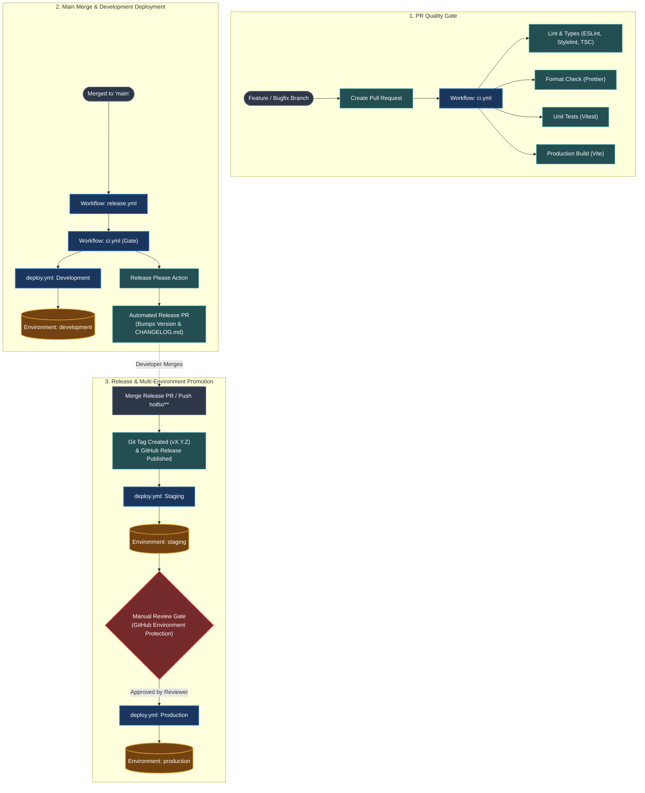

# CI/CD Pipeline Architecture & Documentation

This directory contains the GitHub Actions automation, release lifecycle, and environment deployment configuration for the Vite Single Page Application.

---

## 1. High-Level Architecture & Flow

---

## 2. Core Workflows Explained

### A. CI Workflow (`ci.yml`)
- **Trigger**: Runs on every `pull_request` event targeting branches or called reusable via `workflow_call`.
- **Purpose**: Fast feedback loop preventing broken code, syntax errors, or regression bugs from landing in protected branches.
- **Jobs & Steps**:
  1. Checks out repository source code.
  2. Sets up Node.js runtime according to `.nvmrc` with native `pnpm` caching.
  3. Installs dependencies using `pnpm install --frozen-lockfile`.
  4. Runs code quality tasks in parallel/sequence:
     - `pnpm lint`: Lints JavaScript, TypeScript, CSS/SCSS, and runs static type-checking.
     - `pnpm format:check`: Validates formatting against Prettier standards.
     - `pnpm test`: Runs Vitest unit tests.
     - `pnpm build`: Verifies that Vite compiles static output without errors.
- **Concurrency**: Cancels earlier queued runs on the same branch if a newer commit is pushed (`cancel-in-progress: true`).

---

### B. Release Orchestrator (`release.yml`)
- **Trigger**: Runs automatically on pushes to `main` and `hotfix/**`.
- **Purpose**: Coordinates deployments across environments and automates Semantic Versioning (SemVer).
- **Execution Lifecycle**:
  1. **`ci` Job**: Verifies test suite passes on the target branch.
  2. **`deploy-development` Job**: Immediately triggers `deploy.yml` with the latest commit SHA and deploys to the `development` environment.
  3. **`release-please` Job**:
     - Evaluates Conventional Commits (e.g., `feat:`, `fix:`, `perf:`).
     - Maintains or updates a tracking Release PR with updated versions in `package.json` and generated release notes in `CHANGELOG.md`.
     - When the Release PR is merged, it tags the commit with `vX.Y.Z` and outputs `release_created: true`.
  4. **`deploy-staging` Job**: Triggers once a release is created, deploying the tag to the `staging` environment.
  5. **`deploy-production` Job**: Waits for `staging` deployment to succeed, then pauses for manual approval via GitHub Environment protection before deploying to `production`.

---

### C. Reusable Deploy Workflow (`deploy.yml`)
- **Trigger**: Called by `release.yml` (`workflow_call`) or run manually (`workflow_dispatch`).
- **Inputs**:
  - `environment`: `development` | `staging` | `production`.
  - `ref`: Git branch, tag, or commit SHA.
- **Steps**:
  1. **Environment Validation**: Asserts required environment variables (e.g., `VITE_BACKEND_BASE_URL`) exist for the target environment.
  2. **Asset Compilation**: Builds optimized production bundles using Vite, embedding target environment name, release version, and short Git commit SHA.
  3. **Deploy Simulation (POC Mode)**:
     - In production, this runs `aws s3 sync` and invalidates AWS CloudFront caches.
     - In this playground/POC, it formats the exact AWS CLI commands, outputs a summary table to `$GITHUB_STEP_SUMMARY`, and uploads the build artifact (`site-<env>`).
  4. **Artifact Archiving**: Stores the compiled `dist/` directory as a downloadable GitHub Action artifact (7-day retention).

---

## 3. Environment Progression Matrix

| Environment | Trigger Condition | Code Reference | Approval Required? | Purpose |
| :--- | :--- | :--- | :---: | :--- |
| **development** | Push to `main` branch | Commit SHA (`HEAD`) | No | Continuous integration testing and active feature validation. |
| **staging** | Merging a Release PR | Release Tag (`vX.Y.Z`) | No | Pre-production testing, QA smoke tests, and final dress rehearsal. |
| **production** | Successful staging deploy | Release Tag (`vX.Y.Z`) | **Yes** (Required Reviewer) | Live customer-facing release. |

---

## 4. Manual Rollbacks & Redeploys

If an issue occurs in `staging` or `production`:
1. Navigate to **Actions** $\rightarrow$ **Deploy** workflow in GitHub.
2. Click **Run workflow**.
3. Select the target **Environment** (`staging` or `production`).
4. Enter the desired stable tag or commit (e.g., `v1.2.0`).
5. Click **Run workflow**. The deployment pipeline will compile and deploy that exact version.
