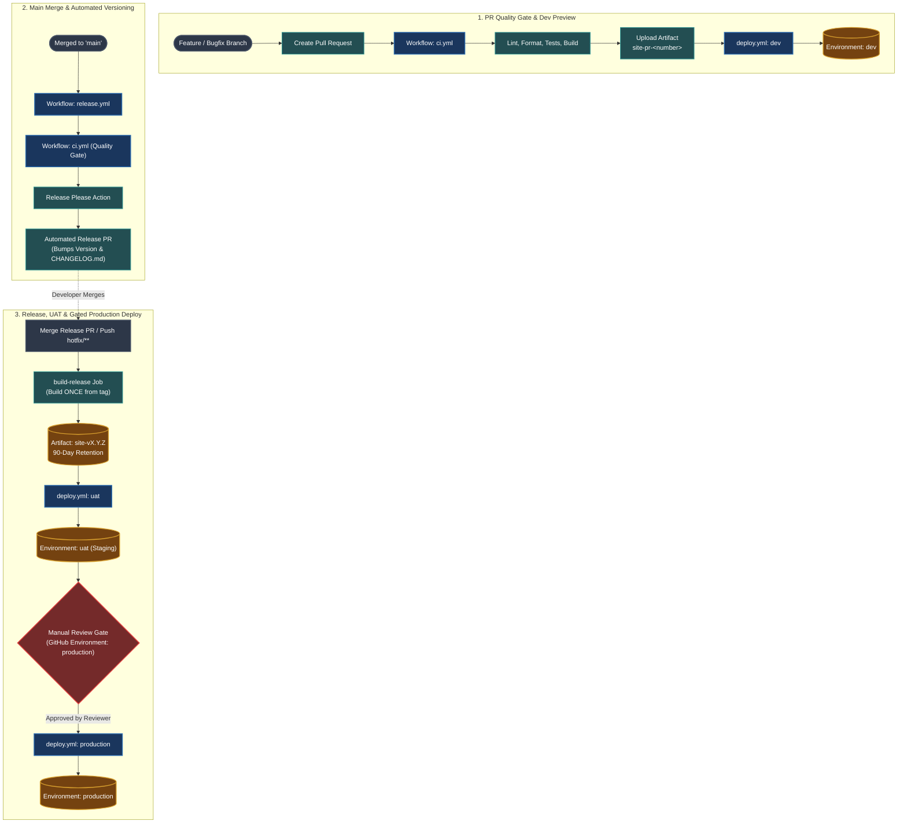

# CI/CD Pipeline Architecture & Documentation

This directory contains the GitHub Actions automation, release lifecycle, artifact storage, and multi-environment deployment configuration for the Vite Single Page Application.

---

## 1. High-Level Architecture & Flow

---

## 2. Core Workflows Explained

### A. CI Workflow (`ci.yml`)
- **Trigger**: Runs on every `pull_request` event or when called by other workflows (`workflow_call`).
- **Purpose**: Fast feedback loop that guarantees quality before merging and spins up an ephemeral dev preview.
- **Jobs & Steps**:
  1. **`check` Job**:
     - Sets up Node.js from `.nvmrc` with cached `pnpm`.
     - Installs locked dependencies via `pnpm install --frozen-lockfile`.
     - Runs `pnpm lint`, `pnpm format:check`, and `pnpm test`.
     - Compiles with Vite for `dev` environment (`VITE_APP_ENV=dev`).
     - Uploads the preview bundle as `site-pr-<number>` (7-day retention).
  2. **`deploy-dev` Job**:
     - Reuses `deploy.yml` with `environment: dev` and tag `pr-<number>`.
- **Concurrency**: Cancels previous active runs on the same branch when new commits are pushed (`cancel-in-progress: true`).

---

### B. Release Orchestrator (`release.yml`)
- **Trigger**: Runs on direct push / merge to `main` and `hotfix/**`.
- **Purpose**: Automates Semantic Versioning, single-source compilation, and sequential promotion to UAT and Production.
- **Execution Lifecycle**:
  1. **`ci` Job**: Re-runs the full CI suite to ensure clean state on `main`.
  2. **`release-please` Job**:
     - Analyzes Conventional Commits (`feat:`, `fix:`, `perf:`).
     - Maintains a Release PR updating `package.json` and `CHANGELOG.md`.
     - When merged, it tags `vX.Y.Z` and sets `release_created: true`.
  3. **`build-release` Job**:
     - Checks out the official release tag `vX.Y.Z`.
     - **Compiles ONCE** with Vite for production.
     - Uploads the immutable artifact: **`site-vX.Y.Z`** (90-day retention).
  4. **`deploy-uat` Job**:
     - Downloads `site-vX.Y.Z` artifact and deploys it immediately to the **`uat`** (staging) environment.
  5. **`deploy-production` Job**:
     - Waits for UAT deployment to succeed.
     - Downloads the exact same `site-vX.Y.Z` artifact.
     - Deploys to **`production`** (pauses if GitHub Environment Required Reviewer is enabled).

---

### C. Reusable Deploy Workflow (`deploy.yml`)
- **Trigger**: Called by `ci.yml` / `release.yml` (`workflow_call`) or run manually (`workflow_dispatch`).
- **Inputs**:
  - `environment`: `dev` | `uat` | `production`.
  - `tag`: Version tag or PR identifier (e.g., `v1.1.0` or `pr-1`).
- **Key Principle — Artifact as Source of Truth**:
  - **No source compilation or npm installs occur here.**
  - Downloads `site-${{ inputs.tag }}` artifact directly.
  - Deploys the pre-built static bundle to the target environment.
  - Writes a comprehensive deployment summary to `$GITHUB_STEP_SUMMARY`.

---

## 3. Environment Progression Matrix

| Environment | Trigger Condition | Artifact Used | Approval Required? | Purpose |
| :--- | :--- | :--- | :---: | :--- |
| **dev** | Opened / Updated PR | `site-pr-<number>` | No | Ephemeral review & testing before merge. |
| **uat** (Staging) | Merged Release PR | `site-vX.Y.Z` | No | Automated UAT validation & QA sign-off. |
| **production** | Successful UAT Deploy | `site-vX.Y.Z` | **Yes** (Required Reviewer) | Live user-facing production release. |

---

## 4. Rollback & Hotfix Procedures

### Rollback (Instant, Zero Build Time)
If production or UAT experiences issues:
1. In GitHub, go to **Actions** $\rightarrow$ **Deploy**.
2. Click **Run workflow**.
3. Select target **Environment** (`production` or `uat`).
4. Enter the known healthy release tag (e.g., `v1.0.0`).
5. Click **Run workflow**. The pipeline fetches `site-v1.0.0` from GitHub Actions storage and deploys it immediately without rebuilding.

### Hotfix (Single Trunk Model)
1. Branch off the offending commit on `main`: `git checkout -b hotfix/fix-login-error <commit-sha>`.
2. Commit the fix using Conventional Commits: `git commit -m "fix: resolve login auth error"`.
3. Open PR directly to `main` $\rightarrow$ CI validates and deploys to `dev`.
4. Merge PR $\rightarrow$ `release-please` automatically produces a patch release (e.g., `v1.0.1`) $\rightarrow$ deploys to `uat` and `production`.
